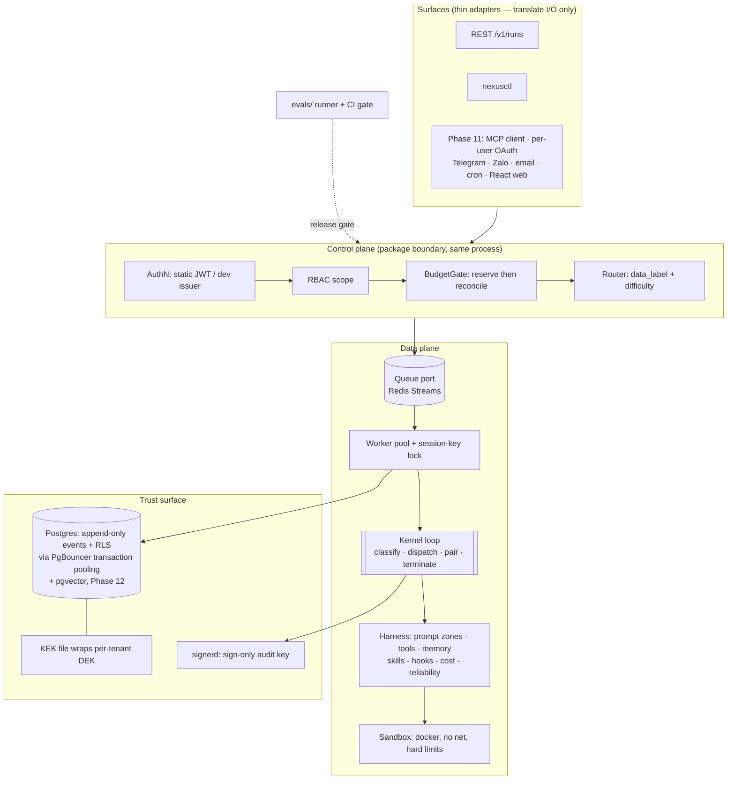

# 🧭 Nexus Agent Demo — A Production-Shaped Agent Platform in One Go Binary

### A multi-tenant, governed agent kernel with append-only state, hash-chained audit and human approval. Provider-agnostic, and deterministic to test

**One loop, many surfaces.** `nexusd` runs the control plane, the durable-queue workers, the kernel loop and the REST
surface as a single Go process over Postgres + PgBouncer + Redis. Every conversation is an **append-only, envelope-encrypted
event log** with a **hash-chained, signer-attested audit trail**. Every tool call walks a **16-step pipeline** and a
**10-layer permission chain**, and every model call is **budget-reserved before it streams**.

It is a simplified, single-binary Go reimplementation of [`truongpx396/nexus-agent`](https://github.com/truongpx396/nexus-agent)
that keeps every architectural seam and control and collapses only deployment topology, scale-out infrastructure and the
commercial tail ([§2](#2-the-simplification-thesis)). Around the kernel sit tools (built-ins, an MCP client, per-user OAuth
connectors), skills, sub-agent delegation and peer teams, a declarative orchestration plane, file-first memory, a pgvector
retrieval tier and a Docker or OpenSandbox sandbox. The model is behind one port with three adapters: a scripted `fake` (the
default, so everything runs with no credentials), `anthropic`, and `litellm` for any OpenAI-compatible model, local Ollama
included.

> **Status:** a reference implementation, not a deployed service. The `--dev` path is zero-setup; outside it `nexusd`
> fails closed on any unset security-critical setting. What stands between this and production is tracked in
> [`docs/production-readiness-review.md`](docs/production-readiness-review.md) and [`docs/go-live.md`](docs/go-live.md).

[](https://github.com/truongpx396/nexus-agent-demo/actions/workflows/ci.yml)
[](#-quickstart)
[](#-highlights)
[](#-safety-and-trust)
[](#-safety-and-trust)
[](#-configuration)
[](docs/build-phases.md)
[](#4-testing-strategy)

* * *

## 📑 Table of Contents

- [🎯 Highlights](#-highlights)
- [🚀 Quickstart](#-quickstart)
- [💬 Things to try](#-things-to-try)
- [🌐 HTTP API and CLI](#-http-api-and-cli)
- [🧩 Configuration](#-configuration)
- [🔒 Safety and trust](#-safety-and-trust)
- [📊 Observability](#-observability)
- [🔧 Make targets](#-make-targets)
- **Design narrative** (cited across the code and docs by number)
  - [1. What the original is, in one page](#1-what-the-original-is-in-one-page)
  - [2. The simplification thesis](#2-the-simplification-thesis)
  - [3. Target architecture of the demo](#3-target-architecture-of-the-demo)
  - [4. Testing strategy](#4-testing-strategy)
  - [5. Explicitly out of scope](#5-explicitly-out-of-scope-and-the-trigger-that-would-change-that)
  - [6. Source references](#6-source-references)
- [🩺 Troubleshooting](#-troubleshooting)

* * *

## 🎯 Highlights

| Layer | What it is |
|---|---|
| 🧠 **Kernel** | `kernel/`: one `iter.Seq2` generator (observe → think → act). Typed response classification, 8 typed terminal reasons, and a paired `tool_use`/`tool_result` invariant that is property-tested over generated histories |
| 🔀 **Models** | `internal/provider`: one port and one normalized stream. `fake` (default) · `anthropic` · `litellm`, with a deterministic router (data label × difficulty) and failover that commits at the first emitted chunk |
| 🛠️ **Tools** | `internal/tools` 16-step pipeline · `internal/permissions` 10-layer chain · hooks (command, HTTP, prompt) · Docker or OpenSandbox sandbox · Crawl4AI · MCP client |
| 💾 **State** | A Postgres append-only event log (a trigger rejects UPDATE/DELETE for every role). Status, taint and terminal reason are projections rebuilt by replay; checkpoints, snapshots and write-ahead idempotency claims are three separate artifacts |
| 🏢 **Tenancy** | Row-level security **enabled and forced** on every tenant table, scoped by a transaction-local `set_config` and proven *through* PgBouncer in transaction-pooling mode |
| 🔐 **Trust** | Per-tenant envelope encryption (erasure is crypto-shredding), hash-chained audit receipts signed by a separate `signerd`, content-free telemetry behind a deny-by-default allowlist |
| 💵 **Cost** | Integer money, a versioned price book, reserve → stream → reconcile on every model call, an epoch-marked Redis counter, and a typed `cost_exhausted` terminal reason |
| 🚦 **Queue** | Redis Streams consumer group with `XAUTOCLAIM` reclaim, a per-session-key serial lock and stateless workers |
| 🌐 **Surfaces** | REST + SSE · `nexusctl` · Telegram · Zalo · email · cron · MCP · a React web app, all thin translators over the same kernel |
| 🧪 **Evals** | A release gate with k trials, exact confidence intervals, a three-valued verdict, a held-out gap and a baseline regression check; `make eval` is a CI job |

- 🔁 **One loop, many surfaces**: no surface holds control flow, so adding one is an adapter, never a fork of the loop.
- ✋ **Approval is a transaction**: bound to a canonical digest of the exact call, so a modified, expired or invalidated approval is a typed outcome, never a silent re-ask. A suspended run costs zero tokens.
- 🧬 **Append-only state**: the event log is the only mutable runtime state; replay, resume and fork are three named operations.
- 🧱 **Boundaries are tests, not conventions**: an import-graph test fails the build on a forbidden dependency, plus a 500-line file cap, no floats in money and exhaustive switches over terminal reasons.
- 🎲 **Deterministic correctness tests**: nothing that decides pass or fail calls a live model; they run against `internal/provider/fake`.
- 🔍 **Operable**: `nexusd verify-chain`, `dashboard` and `go-live` check the audit chain, the golden signals and the launch checklist against a live deployment.

* * *

## 🚀 Quickstart

**Prerequisites:** 🐹 Go 1.26 (`go.mod` pins the patch release) · 🐳 Docker + Compose · 🟢 Node, only for the web app.
No API key and no model download: the default provider is a scripted fake.

```bash
cp .env.example .env        # optional: every variable has a zero-setup default
make up                     # postgres :5433, pgbouncer :6432, redis :6380
make migrate                # schema + RLS, direct to Postgres (bypasses PgBouncer on purpose)
make seed                   # tenant "acme" and its default price book
make run                    # signerd + nexusd --dev on :8085; keys are generated into .dev/
```

Then, in a second terminal:

```bash
export NEXUS_HTTP_ADDR=http://localhost:8085      # nexusctl wants a URL; nexusd's own setting is a listen address
export NEXUS_TOKEN=$(make -s token | awk '/^token:/ {print $2}')   # `make token` prints tenant_id, user_id and token

./bin/nexusctl run "what is 21 * 2?"
# run_id: 5f8ee7b1-8a45-4227-a891-6bc9666e4263
# watch: http://localhost:8085/v1/runs/5f8ee7b1-8a45-4227-a891-6bc9666e4263

curl -s -H "Authorization: Bearer $NEXUS_TOKEN" $NEXUS_HTTP_ADDR/v1/runs/<run_id>
# {"run_id":"…","status":"completed","terminal_reason":"completed"}
curl -N -H "Authorization: Bearer $NEXUS_TOKEN" $NEXUS_HTTP_ADDR/v1/runs/<run_id>/events      # the event log, as SSE
```

A run's log reads `tool_loaded` (one per resident tool, pinning what the model could see) → `user_message` →
`budget_decision` → `content` → `terminal`. Each `make token` mints a **new user**, and `GET /v1/sessions` lists only
the token's own runs; keep the token, or mint with `./bin/nexusd --dev token --tenant=acme --user=<uuid>` to stay the same user.

**Web app:** `cd web && npm ci && npm run dev`, open http://localhost:5173, and enter the base URL and the token in the header's settings.

**Another model:** `NEXUS_PROVIDER=anthropic ANTHROPIC_API_KEY=… make run`, or a local Ollama model through LiteLLM
([`docs/local-llm.md`](docs/local-llm.md)). **Containers:** `make docker-up` runs `nexusd` and `signerd` from built images against the same infra.

<details>
<summary>🔌 Dev ports</summary>

| Service | Port | Service | Port |
|---|---|---|---|
| nexusd (REST, `/metrics`, `/healthz`, `/readyz`) | :8085 | Postgres (direct: admin and migrations only) | :5433 |
| PgBouncer (runtime, transaction pooling) | :6432 | Redis | :6380 |
| pprof: nexusd / signerd (loopback) | :6060 / :6061 | Web app (Vite) | :5173 |
| LiteLLM (`make llm-up`) | :4100 | Langfuse (`make langfuse-up`) | :3001 |
| Crawl4AI / OpenSandbox (`make agentic-up`) | :11235 / :8090 | Grafana (`make observability-up`) | :3310 |
| Prometheus / Alertmanager / cAdvisor | :9091 / :9094 / :8095 | Loki / Tempo / Pyroscope | :3101 / :3200 / :4040 |

</details>

* * *

## 💬 Things to try

Every example needs the quickstart stack running.

| Try | What it shows |
|---|---|
| `curl -N …/v1/runs/<run_id>/events` after a run | 📜 The append-only log as the API sees it, decrypted only for the run's own audience |
| `make dashboard` | 📈 The golden signals per tenant: terminal-reason mix, stuck rate, cost-ceiling breach rate, cache-read rate, approval p50/p95 |
| `make verify-chain` | 🔗 Walks every tenant's hash-chained audit receipts and anchors, verifies each signature against the trusted public key and exits non-zero on a break or a gap |
| `make go-live` | ✅ The launch checklist across every tenant: automated items checked against the live deployment, manual ones printed as reminders, never as a silent pass ([`docs/go-live.md`](docs/go-live.md)) |
| `make seed TENANT=scratch` then `./bin/nexusd --dev erase --tenant=scratch` | 🧹 Crypto-shredding erasure: the DEK is destroyed and derived rows are deleted, yet the log still replays structurally and the audit chain still verifies. ⚠️ Destructive and irreversible, so use a throwaway tenant |
| `make eval` | 🎯 The release gate over the scripted corpus. A green run ends `PASS`; the judge-graded case reports `inconclusive` (no judge is wired), which is never counted as a pass |
| `go test ./...` | 🧪 Unit and property tests with no services, including the import-boundary and file-size contract tests |
| `go test -tags=integration ./internal/store -run TestIsolation -v` | 🏢 Tenant isolation through PgBouncer: transaction-local scope holds under concurrency, and the session-level variant is shown to leak |
| `go test -race -tags=integration ./...` | 🐳 The full integration suite on disposable Postgres + PgBouncer (testcontainers): Docker must run, `make up` is not needed |

* * *

## 🌐 HTTP API and CLI

`nexusd` serves on `NEXUS_HTTP_ADDR` (default `:8085`). The run, session and approval routes need `Authorization: Bearer <token>`; a token
is minted out of band with `nexusd token --tenant=<name> [--user=<uuid>] [--ttl=24h]` and the principal comes only from its
verified claims (a signed-JWT dev issuer stands in for per-tenant OIDC).

| Endpoint | Purpose |
|---|---|
| `POST /v1/runs` | Start a run (`202` with `run_id`); body `{"input", "autonomy"?, "budget_usd"?}` |
| `GET /v1/runs/{id}` · `GET /v1/runs/{id}/events` | Status and terminal reason · the event log as SSE |
| `GET /v1/sessions` | The caller's runs |
| `POST /v1/runs/{id}/cancel` · `/steer` · `/autonomy` · `/fork` | Run control. Autonomy only ever tightens; a fork replays to a sequence number and disables external effects |
| `GET /v1/approvals` · `GET /v1/approvals/{id}` | Pending approvals with their decision-ready context |
| `POST /v1/approvals/{id}/grant` · `/deny` | Decide an approval; a grant may carry a modified input, which re-binds the digest |
| `POST /v1/sessions/{id}/content-access-grants` · `GET …/content-access-grants/read` | Audited, expiring access to plaintext outside the run's own audience |
| `GET /healthz` · `GET /readyz` · `GET /metrics` | Liveness · readiness (Postgres, Redis and signerd) · Prometheus metrics |
| `POST /v1/webhooks/{telegram,zalo,email}/…` | Inbound delivery for the conversational surfaces, deduplicated and session-locked |

`nexusctl` is a thin client over the same API (`NEXUS_HTTP_ADDR` as a URL, `NEXUS_TOKEN`):

```text
nexusctl run "<input>" [--autonomy=read_only|supervised|autonomous] [--budget=<usd>]
nexusctl approvals list | show <id> | grant <id> [--modify='{"field":"value"}'] | deny <id> --reason="…"
nexusctl cancel <session-id> [--reason="…"]    nexusctl steer <session-id> "<input>"
nexusctl fork <session-id> --at=<seq> [--model=<model-id>]
```

`nexusd` itself also takes `migrate`, `seed`, `token`, `verify-chain`, `dashboard`, `go-live`, `erase` and `ingest`
(`--tenant`, `--file`, `--mime`: convert, scan, embed and index one document). A CORS layer lets the web app call it from another origin;
that is safe because auth is a bearer token the client attaches, never a cookie.

* * *

## 🧩 Configuration

Everything is a `NEXUS_*` environment variable. [`.env.example`](.env.example) documents each one with its default and is
auto-loaded from the working directory; **a real environment variable always wins**, and a `.env` that sets
`NEXUS_PROVIDER` changes what `make run` talks to. Without `--dev`, `nexusd` refuses to start unless
`NEXUS_DATABASE_URL`, `NEXUS_REDIS_ADDR`, `NEXUS_SIGNERD_SOCKET`, `NEXUS_KEK_PATH` and `NEXUS_AUTHN_SIGNING_KEY_PATH` are set.

| Concern | Setting | Notes |
|---|---|---|
| 🔀 Model | `NEXUS_PROVIDER=fake` (default) · `anthropic` · `litellm` | `anthropic` needs `ANTHROPIC_API_KEY` (`NEXUS_ANTHROPIC_MODEL`); `litellm` uses `NEXUS_LITELLM_BASE_URL` and `NEXUS_LITELLM_MODEL`. Local Ollama setup: [`docs/local-llm.md`](docs/local-llm.md) |
| 📦 Sandbox | `NEXUS_SANDBOX=` (unset) · `docker` · `opensandbox` | Unset runs `platform/shell` unsandboxed. OpenSandbox and Crawl4AI: `make agentic-up`, [`docs/agentic-capabilities.md`](docs/agentic-capabilities.md) |
| 🕸️ Egress | `NEXUS_WEB_FETCH_ALLOWLIST` | Comma-separated hosts `platform/web_fetch` may reach; empty means none |
| 🔭 Tracing | `NEXUS_OTLP_ENDPOINT` · `NEXUS_LANGFUSE_HOST` | Either or both; nothing set prints spans to stdout. Content is attached only with `NEXUS_TRACE_CONTENT=true` |
| 🔌 Connectors | `NEXUS_OAUTH_PROVIDERS` and a `NEXUS_OAUTH_<NAME>_*` block per name | Per-user OAuth tokens, sealed under the tenant's key |
| 🗂️ Storage | `NEXUS_WORKSPACE_ROOT` · `NEXUS_BLOB_DIR` · `NEXUS_MEMORY_ROOT` · `NEXUS_SKILLS_ROOT` | Defaults under `.dev/` (skills under `skills/`) |
| 🪵 Logs and profiling | `NEXUS_LOG_LEVEL` · `NEXUS_LOG_FILE` · `NEXUS_PPROF_ADDR` · `NEXUS_PYROSCOPE_ADDR` | `make run` enables log files and loopback pprof by default |

* * *

## 🔒 Safety and trust

The trust surface is day-one and co-equal with the loop, never a retrofit. The mechanisms, each with its code and test:

- 🏢 **Tenant isolation fails closed.** RLS is enabled and forced on every tenant table (`nexusd migrate` asserts it and prints the count). `Store.InTenantTx` is the only scoping call and uses `set_config('app.tenant_id', $1, true)`, which is transaction-local; a session-level `SET` is banned by lint *and* by the isolation test, because the pooler reassigns connections between tenants.
- ⛓️ **Permissions are one total order.** Ten layers, a DENY at any layer is final, there is no bypass mode, and the per-invocation safety check and Rule of Two are always evaluated ([the chain](#3-target-architecture-of-the-demo)). Autonomy is a one-way ratchet: no widening operation exists on any interface.
- ✋ **Approval is a transaction.** Bound to the call's canonical digest, with a named assignee and a TTL; a digest mismatch at execution is a typed `approval_mismatch`.
- 1️⃣ **Side effects are claimed first.** A write-ahead idempotency claim goes `in_flight` before the effect leaves the process, and is resolved by a probe or a human. Nothing ever re-executes silently.
- 🔐 **Keys have separate custody.** A KEK wraps per-tenant DEKs for AES-256-GCM sealing; the audit key lives only in `signerd`, which signs over a unix socket and never reveals it, and `cmd/nexusd` may not import the signer-key package at all.
- 🧾 **The audit chain is verifiable.** Every appended event gets a hash-chained receipt over *digests*, so lawful redaction never breaks verification; chain heads are anchored periodically and `nexusd verify-chain` checks both.
- 🙈 **Telemetry carries no content.** Span attributes pass a deny-by-default allowlist; reading plaintext outside a run's own audience takes an audited, expiring content-access grant.

* * *

## 📊 Observability

`nexusd` exposes `/metrics`, writes structured zerolog JSON, and emits turn-scoped spans derived from the durable log. The
local stack is separate from the app and optional ([`docs/observability.md`](docs/observability.md)):

| Make target | Brings up |
|---|---|
| `make observability-up` | Prometheus + Alertmanager + cAdvisor + Loki + Promtail + Grafana, pre-wired with four dashboards (golden signals, cost and tools, infrastructure, logs) and five alert rules |
| `make tempo-up` · `make profiling-up` | Grafana Tempo for OTLP traces · Grafana Pyroscope for continuous profiles |
| `make langfuse-up` · `make langfuse-lite-up` | Self-hosted Langfuse (full, or the lightweight v2) for per-run agent traces ([`docs/local-llm.md`](docs/local-llm.md)) |
| `make pprof-cpu` · `pprof-heap` · `pprof-goroutine` | On-demand profiles from the loopback pprof listener `make run` starts |

* * *

## 🔧 Make targets

The `##` comments in the [Makefile](Makefile) are the full reference. The ones you will use:

| Target | Does |
|---|---|
| **▶️ Run** | |
| `make up` · `make down` | Start / stop Postgres, PgBouncer and Redis (volumes kept) |
| `make migrate` · `make seed` | Apply migrations incl. RLS (direct to Postgres) · seed a tenant (`TENANT=name`, default `acme`) |
| `make run` · `make signerd` | `signerd` + `nexusd --dev` in the foreground · `signerd` alone |
| `make token` | Mint a dev bearer token for `TENANT` (prints three lines) |
| `make docker-up` · `make docker-down` | Run `nexusd` + `signerd` from built images · stop them (`make down` does not) |
| `make web-build` | Install and build the React app |
| **🔍 Operate** | |
| `make verify-chain` · `make dashboard` · `make go-live` | Audit-chain verification · golden-signal dashboard · launch checklist |
| **✅ Gates** | |
| `make test` · `make lint` · `make eval` | Unit + property tests · golangci-lint (CI also builds with `--build-tags=integration`) · the eval release gate |
| `make eval-baseline` | Regenerate `evals/testdata/baseline.json`; commit the diff only after a deliberate corpus change |
| `make pr-size` | Changed lines versus `origin/main`; CI fails a PR above 1,000 |
| **🧰 Local services** | |
| `make llm-up` · `make langfuse-up` · `make agentic-up` · `make observability-up` | Each in its own compose file, so `make down` never touches them; stop with `llm-down`, `agentic-down`, `observability-down` |

Before calling a change done: `go build ./... && go vet ./... && golangci-lint run --build-tags=integration ./... && go test ./...`.

* * *

> **The design narrative (§1–§6).** What follows is the design record: what the original is, what this demo collapses and
> why, the architecture and its enforced boundaries, the test strategy and what is deliberately out of scope. Code comments and
> docs cite these sections by number (`README §5`), so the numbering is stable; add new topics above this line, not between sections.

---

## 1. What the original is, in one page

Two governing equations drive everything:

```
Reliability      ≈ Model capability × Harness quality      (harness ≈ 80% of quality)
Enterprise-ready ≈ Harness quality  × Trust surface        (security + governance + observability)
```

Five architectural strata, connected by hard contracts:

| Stratum | Job | Non-negotiable property |
|---|---|---|
| **Surfaces** | CLI / REST / chat / web / email / cron / Telegram / Zalo / agent-ingress | Thin translators. Zero control flow. Declare a capability descriptor. |
| **Control plane** | AuthN (per-tenant OIDC), RBAC, rate limits, budgets, routing | Deterministic, auditable. Separately deployable behind a versioned contract. |
| **Data plane** | Durable queue (Redis Streams) → stateless worker → kernel loop → harness → sandbox | All state externalized. Can move into a customer VPC by configuration. |
| **Kernel** | `observe → think → act`, one async generator | Typed response classification; typed terminal reason; paired `tool_use`/`tool_result`. |
| **Trust surface** | RLS, vault, envelope encryption, hash-chained audit, content-free telemetry, approval, sandbox, Rule of Two | Day-one, co-equal perimeter controls — never a retrofit. |

The nine constitutional principles, compressed:

1. **One loop, many surfaces** — no per-surface control-flow fork.
2. **Immutable models, append-only state** — the event log is the only mutable runtime state.
3. **Cache-stable context is architecture** — byte-stable prefix + volatile tail, >90% cache-read.
4. **Stop on cost, not vibes** — pre-spend reservation, hard ceilings, `cost_exhausted`.
5. **Safety is per-invocation and fails closed** — parsed input, layered defense, Rule of Two.
6. **Tenant first; audit + observability day one** — RLS with transaction-local scope, hash-chained receipts, content-free telemetry.
7. **Model/provider-agnostic by abstraction** — one provider port, native tool calling, deterministic routing.
8. **Classify, resume, never silently retry** — typed failure classes, durable checkpoints, circuit break.
9. **Verify against acceptance criteria; govern every change** — evals as the release gate, before the first behavior-bearing slice.

---

## 2. The simplification thesis

The original's own MVP cut line states the rule this plan inherits verbatim:

> **Seams and schema decisions are made early because they are expensive to retrofit;
> infrastructure is added late because it is cheap to add and expensive to carry.**

So the demo keeps **every seam, every contract, and every control**, and collapses only
**deployment topology, scale-out infrastructure, and the commercial/compliance tail**.

Concretely, three collapses:

| Collapse | Original | Demo | Why it's honest |
|---|---|---|---|
| **Deployment** | 3 Go binaries (`control-plane`, `runtime-worker`, `surface-gateway`) + Python helper + React app | 1 binary `nexusd` (+ `nexusctl` CLI, + `signerd` for key custody) | The control↔data-plane split stays a **Go interface** (`controlplane.Port`) with a versioned request/response shape, and the packages never import across the boundary. Splitting into processes later is a `main.go` change, not a rewrite. |
| **Infrastructure** | NATS JetStream, gVisor/Kata warm pool, S3, KMS/HSM, external vault, PgBouncer, OTel collector, pgvector | Redis Streams (`internal/queue/redis/streams.go` — a consumer group + `XAUTOCLAIM`; Postgres `SKIP LOCKED` was the original demo's own stand-in, retired in `migrations/0024_retire_queue_jobs.sql`), Docker sandbox (no warm pool), local blob dir, file-backed KEK + `signerd`, PgBouncer (kept — it's load-bearing), stdout OTLP | Each sits behind a port with one adapter — `internal/queue.Port`'s own doc comment names this exact swap as the reason it exists. The original's own cut line still defers NATS JetStream; Redis Streams is a second, closer-to-production demo stand-in ahead of it, not the final word. **PgBouncer is kept** because the transaction-local RLS rule is meaningless without a transaction pooler to prove it against. |
| **Commercial + compliance tail** | Credit ledger, billing periods, FX, price overrides, multi-region residency, BYOK, chargeback export, MCP/OAuth connectors, Telegram/Zalo, document conversion, retrieval tier, adversarial scan, adaptation proposals | Dropped (columns kept where they're schema seams) | These are business processes, not patterns. Dropping them removes ~60 of 191 FRs and zero architectural ideas. |

Everything else — the kernel, the pipeline, the permission chain, the approval transaction,
the audit chain, the erasure model, the cost gate, the orchestration plane, delegation,
the eval gate — ships **in full**, because each *is* the pattern.

The full pattern-by-pattern fidelity scoring (67 rows) and the phase-by-phase build plan
(Phase 0 through Phase 19) live in [`docs/build-phases.md`](docs/build-phases.md) — split out
to keep this narrative readable. Score: 57 of 67 patterns at full or simplified fidelity, 4 as
seams, 6 deliberately out of scope. Phases 13–15 (added after
[`docs/production-readiness-review.md`](docs/production-readiness-review.md)) and Phase 18 close gaps
between what several **F**-rated patterns claimed and what the shipped code did, and Phase 19
makes the core depend on ports rather than on Postgres (hexagonal persistence and use-case seams);
none of them changes that score.

---

## 3. Target architecture of the demo



### Repository layout

```text
nexus-agent-demo/
├── cmd/
│   ├── nexusd/                 # the single binary: control plane + worker pool + REST surface
│   ├── nexusctl/               # CLI surface adapter — the second surface that proves Principle I
│   └── signerd/                # sign-only audit-chain key custody over a unix socket
├── kernel/                     # THE LOOP — no imports from internal/surfaces or internal/controlplane
│   ├── loop.go                 # iter.Seq2[Event,error] generator; the only control flow in the system
│   ├── classify.go             # TOOL_CALLS | CONTENT | EMPTY
│   ├── terminal.go             # the 8 typed terminal reasons + their producers
│   └── hygiene.go              # pre-call pass: orphan drop, synthetic backfill, stale prune
├── internal/
│   ├── provider/               # port + normalized stream + anthropic/ + fake/ + router + failover
│   ├── tools/                  # identity, manifest, admission, registry, pipeline (16 steps), builtin/
│   ├── permissions/            # the 10-layer chain, autonomy ratchet, profiles, safety/, ruleoftwo
│   ├── hooks/                  # dispatcher + command|http|prompt handlers + bounding guards
│   ├── oversight/              # approvals + input requests over one durable-suspend mechanism, as a unit-of-work Store
│   │   └── postgres/           # its Store: the approval/input SQL and tenant scope
│   ├── promptctx/              # two-zone builder, cache measurement, pruning, condensation
│   ├── memory/                 # file-first, screening, retention (the window comes from config.Loader)
│   ├── skills/                 # bundles, digests, 3-tier disclosure, capability intersection
│   ├── cost/                   # money, meters, price book, reserve/reconcile, budget decisions — Ledger and Counters ports
│   │   ├── postgres/           # Ledger: reservations, records, price book, budget decisions
│   │   ├── redis/              # Counters: the tenant-ceiling, epoch-marked
│   │   ├── inmem/              # both ports in memory, so the Gate is unit-tested with no database
│   │   └── costtest/           # the contract suite every adapter passes
│   ├── audit/                  # receipt vocabulary, hash input, signer client, verifier report — no persistence
│   │   └── postgres/           # the hash chain itself: Append, Anchor, Verify
│   ├── crypto/                 # KEK/DEK envelope, seal/open — no persistence
│   │   └── postgres/           # KeyStore, crypto-shredding, derived-artifact reconcile
│   ├── eventlog/               # event-log domain model: Event, type taxonomy, session statuses, Appender — no persistence
│   │   ├── postgres/           # kernel.EventLog adapter: one tenant-scoped tx per call, audit receipt in the same tx
│   │   ├── inmem/              # kernel.EventLog adapter for tests: the loop runs with no database
│   │   ├── logtest/            # the contract suite both adapters pass
│   │   └── sealed/             # eventlog.Appender over Postgres: seal under the session key, append, chain — one copy for every out-of-band writer
│   ├── store/                  # Postgres adapter: events, projections, checkpoints, snapshots, claims, RLS scoping
│   ├── queue/                  # Queue port, worker pool, admission control
│   │   └── redis/              # Redis Streams adapter + the session-key lock
│   ├── reliability/            # classifier, backoff, breaker, stuck detector
│   ├── runctl/                 # steer, cancel, resume, replay, fork, tightenAutonomy, the claim ledger — over a unit-of-work Store
│   │   └── postgres/           # its Store: claims, the awaiting_input claim, the autonomy write
│   ├── runstate/               # one place that rebuilds a kernel.RunState from a session's history (generic over a service's own Tx)
│   ├── sandbox/                # docker exec, limits, deny-net, (optional) broker
│   ├── plan/                   # orchestration plane: schema, validator, predicate AST, evaluator, lifecycle
│   │   └── postgres/           # orchestration_plans and the executor's writes
│   ├── delegate/               # sub-agent seam (a tool invocation, not a side channel)
│   │   └── postgres/           # delegations and fan-out envelopes; Bind and CreateEnvelope for callers that hold a transaction
│   ├── teams/                  # peer teams: roster, shared board, shared budget envelope, atomic end
│   │   └── postgres/           # teams, board cards, team envelopes
│   ├── runs/                   # application layer: the run-admission use case (Launcher/Service) and the vocabulary surfaces share
│   │   └── postgres/           # its Postgres adapters: session admission (+ budget), per-session key provisioning, and the Reader REST's GET endpoints use
│   ├── surfaces/               # rest/, cli/, telegram/, zalo/, email/, cron/, mcp/ — Phase 11 adds the last five
│   │   ├── postgres/           # the surfaces' shared adapters: inbound dedup and the delivery ledger
│   │   ├── cron/postgres/      # the schedule store, including the atomic fire
│   │   └── mcp/postgres/       # the MCP server directory
│   ├── connectors/             # Phase 11: per-user OAuth token vault, sealed under crypto/
│   │   ├── postgres/           # Connections: the sealed tokens
│   │   └── redis/              # StateStore: the single-use authorization-code state
│   ├── retrieval/              # Phase 12: the embed-and-search service over an Index port
│   │   └── postgres/           # the pgvector Index, tenant-scoped like every other table
│   ├── ingest/                 # Phase 12: document conversion — PDF/DOCX/HTML → scanned, digested chunks
│   ├── obs/                    # allowlisted attributes, log-derived spans, content-access grants, report composition
│   │   └── postgres/           # dashboard and usage queries, the grant store
│   ├── harness/                # harness_digest computation
│   ├── config/                 # tenant config and its Loader port — config, never forks
│   │   └── postgres/           # the Loader over tenant_configs, plus the transaction-level Load/Upsert the seed command composes
│   ├── controlplane/           # the versioned CP<->DP contract as Go interfaces + local impl
│   ├── authn/                  # resolves a bearer token to a tenant/user principal (the signed-JWT dev issuer)
│   ├── evalgate/               # glue between the plan lifecycle's eval hook and the release gate (evals.Gate)
│   ├── dotenv/                 # the .env loader every binary calls first; a real env var always wins
│   └── version/                # the build identity shared by every binary
├── web/                        # Phase 11: React app over the existing REST + SSE API — no backend surface change
├── migrations/                 # numbered SQL, expand/contract discipline, RLS policies
├── evals/                      # corpus/*.yaml, runner, graders, judge, digest, CI gate
├── skills/                     # skill bundles (GUIDE.md + skill.json) loaded from NEXUS_SKILLS_ROOT
├── deploy/
│   ├── docker-compose.yml      # postgres, pgbouncer(:6432, transaction pooling), redis; signerd + nexusd under the `app` profile
│   ├── docker-compose.local-llm.yml       # LiteLLM, Langfuse (docs/local-llm.md)
│   ├── docker-compose.agentic.yml         # Crawl4AI, OpenSandbox (docs/agentic-capabilities.md)
│   ├── docker-compose.observability.yml   # Prometheus, Alertmanager, Loki, Grafana, Tempo, Pyroscope (docs/observability.md)
│   └── litellm/ observability/ # their configs, dashboards and alert rules
├── tests/
│   ├── contract/               # import boundaries, file-size cap, cost and embedding metering
│   ├── integration/            # black-box: REST run, ceiling, HITL, resume race, erasure, retrieval, surfaces dedup
│   └── property/               # paired-result invariant over generated histories
├── docs/                       # build ledger, constitution, go-live, local-LLM, observability and review docs
├── specs/ .specify/            # Spec Kit feature specs and the constitution (the code-review checklist)
├── CLAUDE.md                   # working rules for contributors and coding agents
└── README.md                   # this file
```

The tenant-isolation test that runs through PgBouncer is white-box and lives beside the code it needs, in
`internal/store/isolation_integration_test.go`.

**Import boundary rule (enforced by a test, not a convention):**
`kernel/` is the core of the hexagon: it may import `internal/{eventlog,provider,tools,promptctx,cost,reliability,obs}`
and nothing else, and reaches durable state only through the `kernel.EventLog` port — never `internal/store`,
a database driver, or an adapter of its own ports (`internal/eventlog/{postgres,inmem}`). The same holds for
everything it imports for vocabulary: `cost`, `obs`, `crypto`, `audit`, `runs`, `controlplane`, `tools`, `oversight`,
`config`, `memory`, `retrieval`, `connectors`, `runctl`, `runstate`, `delegate`, `teams`, `plan`, `queue` and every surface each have a rule of their own that none of them reaches
`internal/store`, `pgx` or `redis` even transitively, because their storage lives in a `postgres/` (or `redis/`, `inmem/`)
subpackage that only `cmd/nexusd`, the composition root, wires in.
`internal/surfaces/` may not import `kernel/`. `internal/controlplane/` may not import
`internal/{sandbox,memory,provider}`. `internal/eventlog/` (the domain model) imports nothing from this module and no
database driver. A `tests/contract/boundaries_test.go` walks the import
graph with `go/packages` and fails the build on a violation — this is what keeps the
"physical split later is a deployment change" claim true.

### Core schema (the part that cannot be retrofitted)

```sql
-- Every tenant-scoped table carries tenant_id and an RLS policy. No exceptions.
CREATE TABLE events (
  event_id        uuid PRIMARY KEY,
  session_id      uuid NOT NULL,
  tenant_id       uuid NOT NULL,
  seq             bigint NOT NULL,
  schema_version  int  NOT NULL,             -- envelope version; upcasting path documented
  type            text NOT NULL,             -- the ~40-type taxonomy
  payload         bytea,                     -- AES-256-GCM ciphertext under the tenant DEK
  payload_digest  bytea NOT NULL,            -- over PLAINTEXT; survives crypto-shredding
  key_id          text NOT NULL,             -- destroying this key IS erasure
  actor           text NOT NULL,             -- model | tool | user | system
  tool_id         text,                      -- {namespace}/{name}@{version}
  pair_ref        uuid,                      -- tool_result -> tool_use  (THE invariant)
  model_id        text,
  trace_id        bytea, span_id bytea,      -- the bidirectional join key
  created_at      timestamptz NOT NULL DEFAULT now(),
  UNIQUE (session_id, seq)
);
ALTER TABLE events ENABLE ROW LEVEL SECURITY;
CREATE POLICY events_tenant ON events
  USING (tenant_id = current_setting('app.tenant_id', true)::uuid);
-- events are append-only: no UPDATE/DELETE grant to the app role, enforced by a trigger too.

CREATE TABLE sessions (
  session_id uuid PRIMARY KEY, session_key text NOT NULL, tenant_id uuid NOT NULL,
  surface_id text NOT NULL, user_id uuid NOT NULL, audience_ref text,
  agent_id uuid NOT NULL, agent_version int NOT NULL,        -- pinned at run start
  harness_digest bytea NOT NULL,                             -- pins ALL behavior-bearing config
  forked_from_session_id uuid, fork_seq bigint, fork_overrides jsonb,
  data_label text NOT NULL, route_model_id text NOT NULL, route_reason jsonb NOT NULL,
  execution_class text NOT NULL, priority int NOT NULL, region text NOT NULL,
  parent_session_id uuid, root_session_id uuid NOT NULL, depth int NOT NULL DEFAULT 0,
  delegation_role text NOT NULL DEFAULT 'root',
  plan_id uuid, plan_version int,
  taint_state jsonb NOT NULL,        -- PROJECTION
  status text NOT NULL,              -- PROJECTION
  autonomy_level text NOT NULL,      -- pinned, ratcheting
  terminal_reason text,              -- PROJECTION
  active_ms bigint NOT NULL DEFAULT 0, suspended_ms bigint NOT NULL DEFAULT 0,
  created_at timestamptz NOT NULL DEFAULT now()
);
```

Plus, all with `tenant_id` + RLS: `checkpoints`, `snapshots`, `idempotency_claims`,
`approvals`, `input_requests`, `audit_receipts`, `audit_anchors`, `encryption_keys`,
`cost_records`, `budgets`, `budget_reservations`, `budget_decisions`, `price_book`,
`tools`, `tool_profiles`, `catalog_manifests`, `effect_classes`, `approval_policies`,
`skills`, `skill_bundle_files`, `memories`, `derived_artifacts`, `sandboxes`,
`surfaces`, `surface_identities`, `delivery_records`, `delegations`,
`orchestration_plans`, `content_access_grants`.

33 tenant tables today (`nexusd migrate` asserts RLS on every one). The original has ~50; the dropped set is billing, FX, connectors, integration
adapters, the eval entities (which live in `evals/` as files here, not rows), and — as of
`migrations/0024_retire_queue_jobs.sql` — the job queue itself, now a Redis Streams
consumer group (`internal/queue/redis/streams.go`) instead of a Postgres table.

Phases 11–12 add their own tables when they ship — `oauth_tokens` (`tenant_id`, `user_id`,
`provider`, sealed under the same per-tenant DEK as any encrypted payload) and
`retrieval_chunks` (`tenant_id`, `doc_id`, `chunk_id`, `embedding`, `source_digest`) — both
`tenant_id`-scoped and RLS-enabled like every table above; nothing about them changes the Phase 1
schema, which is the whole point of adding them late.

**Tenant scoping — the only sanctioned form:**

```go
// internal/store/tenant.go — every read/write path goes through this. No exceptions.
func (s *Store) InTenantTx(ctx context.Context, tenantID uuid.UUID, fn func(ctx context.Context, tx pgx.Tx) error) error {
    return pgx.BeginFunc(ctx, s.Pool, func(tx pgx.Tx) error {
        // transaction-local, parameterised. SET LOCAL cannot take a parameter; set_config(.., true) can.
        if _, err := tx.Exec(ctx, `SELECT set_config('app.tenant_id', $1, true)`, tenantID.String()); err != nil {
            return err
        }
        return fn(ctx, tx)
    })
}
```

Session-level `SET` is banned by a lint rule *and* by the isolation test running through
PgBouncer in transaction-pooling mode — the whole point being that a connection is
reassigned between tenants between statements.

### Key interfaces (the kernel ABI, translated to Go)

```go
// kernel/loop.go — the generator. This is the ONLY place control flow lives. Seed, Resume,
// ResumeDelegation, Continue and ResumeConversation enter the same loop at other points.
func (k *Kernel) Run(ctx context.Context, st *RunState, cfg RunConfig) iter.Seq2[eventlog.Event, error]

// internal/provider — one abstraction, native tool calling only, usage split by class.
type Provider interface {
    Stream(ctx context.Context, p Prompt, tools []ToolSchema, rc RunContext) (Stream, error)
}
type Chunk struct {
    Kind      ChunkKind // content | reasoning | tool_use | usage | done
    Text      string
    Opaque    []byte    // reasoning: round-tripped, never shown
    ToolUseID, ToolName string
    Input     json.RawMessage
    Usage     Usage     // InputUncached, InputCacheRead, InputCacheWrite, Output
    Done      DoneReason // stop | max_output | error
}

// internal/tools — self-describing; every field of Taint defaults to TRUE.
type Tool interface {
    ID() ToolRef                         // {namespace}/{name}@{version}
    Descriptor() Descriptor              // description, schemas, digest, disclosure, effect class
    Taint() Taint                        // returns_untrusted, reads_private_data, mutates_external
    IsConcurrencySafe(input json.RawMessage) bool   // PER INVOCATION, default false
    CheckPermissions(ctx context.Context, in json.RawMessage, rc RunContext) PermissionResult
    ValidateInput(ctx context.Context, in json.RawMessage, rc RunContext) error
    Call(ctx context.Context, in json.RawMessage, rc RunContext) (Result, error)
}

// internal/cost — Gate.Reserve is called BEFORE every Provider.Stream, including auxiliary calls.
func (g *Gate) Reserve(ctx context.Context, req ReserveRequest) (Reservation, error)                       // -> cost_exhausted on refusal
func (g *Gate) Reconcile(ctx context.Context, res Reservation, usage provider.Usage, reported bool) error  // reported=false: reconcile at the full reserved worst case
func (g *Gate) Record(ctx context.Context, tenantID, sessionID uuid.UUID, meter MeterID, qty int64, modelID string) error

// internal/oversight — approval and elicitation share suspension and nothing else.
// Two services over one unit-of-work Store (Postgres adapter: internal/oversight/postgres).
func (a *Approvals) Create(ctx context.Context, req CreateApprovalRequest) (Approval, error)
func (a *Approvals) Grant(ctx context.Context, tenantID, approvalID uuid.UUID, decidedBy string) (Approval, error)
func (a *Approvals) GrantModified(ctx context.Context, tenantID, approvalID uuid.UUID, decidedBy string, modifiedInput json.RawMessage) (Approval, error)
func (a *Approvals) Deny(ctx context.Context, tenantID, approvalID uuid.UUID, decidedBy, reason string) (Approval, error)
func (a *Approvals) Invalidate(ctx context.Context, tenantID, sessionID uuid.UUID, reason InvalidationReason) (*Approval, error)
func (i *Inputs) RequestInput(ctx context.Context, p RequestInputParams) (InputRequest, error)

// kernel/ports.go — the only durable surface the loop sees (Phase 19). Adapters:
// internal/eventlog/postgres in production, internal/eventlog/inmem so the loop runs with no database.
type EventLog interface {
    Append(ctx context.Context, e eventlog.Event) (eventlog.Event, error)
    SetStatus(ctx context.Context, tenantID, sessionID uuid.UUID, status string, terminalReason *string) error
    RecordSuspension(ctx context.Context, req SuspendRequest) error         // an approval suspension
    RecordDelegation(ctx context.Context, req DelegateSuspendRequest) error // a delegation suspension
}
// One log, three artifacts that are never interchangeable (internal/store, internal/runctl):
// the condensation (model-facing), the checkpoint (machine-facing resume) and the snapshot (disposable).
// Write-ahead idempotency claims go in_flight BEFORE an effect leaves the process and are never re-executed.

// internal/controlplane — the versioned boundary. One process today, two later.
type Port interface { // v1
    AdmitRun(context.Context, AdmitRunV1) (AdmitRunResultV1, error)
    ReserveBudget(context.Context, ReserveBudgetV1) (ReserveBudgetResultV1, error)
    ReportCost(context.Context, ReportCostV1) error
    EmitAuditReceipt(context.Context, EmitAuditReceiptV1) error
    RequestApproval(context.Context, RequestApprovalV1) (RequestApprovalResultV1, error)
    AuthorizeContentAccess(context.Context, AuthorizeContentAccessV1) (GrantV1, error)
}
```

### The permission chain, verbatim from the original

```go
// internal/permissions/chain.go — one published TOTAL order. Every invocation walks it.
//  1  Deny rules (tenant/tool/pattern)  -> DENY (final)
//  2  PreToolUse hooks                  -> DENY (final) | ASK | DEFER      (never ALLOW)
//  3  Autonomy level (pinned, ratchet)  -> DENY | ASK | DEFER
//  4  Gate 1: tool profile membership   -> DENY | DEFER                    (never ALLOW)
//  5  Gate 2: capability metadata       -> DENY | ASK | DEFER
//  6  Gate 3: per-invocation safety     -> DENY | ASK | DEFER   ALWAYS EVALUATED
//  7  Rule of Two (taint + declaration) -> ASK  | DEFER          ALWAYS EVALUATED
//  8  Approval policy                   -> AUTO | ASK(once|session|multi_party)
//  9  Standing scope / batch / preauth  -> SATISFIES an ASK      (never suppresses one)
// 10  Otherwise                         -> ALLOW
//
// Two invariants make the order load-bearing rather than decorative:
//   - a DENY at any layer is final; there is no bypass mode in this system.
//   - layers 6 and 7 are unconditional; a remembered "yes" answers a question,
//     it never grants permission to stop asking it.
// Skills sit BELOW this table as an intersection pre-filter, never as a layer —
// a layer could resolve ALLOW, and "load this skill" must never widen anything.
```

---

## 4. Testing strategy

| Layer | What | Where |
|---|---|---|
| **Property** | The paired-result invariant over *generated* histories — it is a total invariant, so examples are not enough | `tests/property/` |
| **Deterministic** | All correctness tests run against `provider/fake` — they never flake and never bill | everywhere |
| **Contract** | Kernel ABI, control↔data-plane `v1`, run-API OpenAPI, import boundaries | `tests/contract/` |
| **Integration** | Isolation **through PgBouncer**, resume-from-checkpoint, concurrent ceiling, approval transaction, erasure-then-verify | `tests/integration/` |
| **Adversarial** | Consent suppression/simulation, mid-run autonomy widening, standing-scope escape, descriptor swap after admission, skill capability widening | `evals/corpus/safety/` |
| **Eval gate** | The only place live models are called; governed by trial statistics rather than determinism | `evals/` |

Two rules carried over verbatim from the original, because they are what make the rest mean anything:

1. **The eval gate ships in Phase 1**, before the first behavior-bearing slice — the window in
   which changes have the largest effect sizes is otherwise the window in which they go unmeasured.
2. **Correctness tests never call a live model.** A non-deterministic dependency gets a
   deterministic harness, or the suite measures the weather.

## 5. Explicitly out of scope (and the trigger that would change that)

Same discipline as the original's cut line — each is additive against the Phase 1 schema, so
none requires migrating the event log, the audit chain, or the encryption model.

| Deferred | Trigger |
|---|---|
| NATS JetStream; multi-process worker pool | Concurrency exceeds one process's comfortable load |
| gVisor/Kata runtime classes, warm sandbox pool | Hostile multi-tenant isolation is required (the image and limits are already identical; it is a `runtimeClassName` change) |
| **Physical** control/data-plane split | A BYOC customer exists — the contract and package boundary already ship |
| Credit ledger, billing periods, FX, price overrides, chargeback export | The platform bills someone |
| Multi-region residency, BYOK, Helm/Terraform, rainbow deploy | A tenant contract requires it; `region` and `key_id` are already columns |
| Temporal (workflow orchestration) | One is actually wanted; the ports exist and the platform must keep working with it off |
| Scheduled adversarial discovery, in-boundary online scorer, adaptation proposals | Production traffic exists to mine |
| In-sandbox broker | The token savings of in-sandbox orchestration are actually needed. **Until then connectors stay in the sandbox egress deny set** — a bypass is never the interim state |

## 6. Source references

Read alongside this document (all in `truongpx396/nexus-agent@2ad2a6a`):

| Document | Why |
|---|---|
| `.specify/memory/constitution.md` | The nine principles. Every design decision here maps to one; it is also the code-review checklist. |
| `specs/001-agent-platform/contracts/kernel-abi.md` | The interface seams translated in §3 — Provider, Tool, Delegation, Memory, Workspace, Surface, Skills, RunControl, Oversight, BudgetGate, Persistence, Telemetry. |
| `specs/001-agent-platform/contracts/tool-contract.md` | The 16-step pipeline and the 10-layer resolution order, verbatim. |
| `specs/001-agent-platform/contracts/orchestration-plane.md` | Plan schema, lifecycle gates, zero-token routing invariant. |
| `specs/001-agent-platform/data-model.md` | Entity fields; the demo's schema is a subset with identical column semantics. |
| `specs/001-agent-platform/plan.md` § MVP cut line | The seams-early/infrastructure-late rule this whole plan inherits. |
| `specs/001-agent-platform/quickstart.md` | The nine validation scenarios; `docs/build-phases.md`'s demo commands are their simplified analogues. |

This repo's own supplementary docs:

| Document | Why |
|---|---|
| [`docs/build-phases.md`](docs/build-phases.md) | The pattern coverage map, the full build plan (Phase 0 through Phase 19), the effort estimate, and the risk register — split out of this file, linked from §2. |
| [`docs/production-readiness-review.md`](docs/production-readiness-review.md) | The audit that found F1–F15 and drove Phase 13. |
| [`docs/webhook-concurrency-review.md`](docs/webhook-concurrency-review.md) | The follow-up audit of Phase 11's conversational webhook surfaces that found `SessionLock` wired into only the async queue worker and no inbound delivery dedup, and drove Phase 18. |
| [`docs/constitution.md`](docs/constitution.md) | The nine principles, copied in verbatim (Phase 0, task 0.6) as the review checklist. |
| [`docs/go-live.md`](docs/go-live.md) | The go-live checklist and what `nexusd go-live` automates versus what stays a manual review. |
| [`docs/local-llm.md`](docs/local-llm.md) | Ollama + LiteLLM + Langfuse: a local model wired into `internal/provider.Provider`, and genuine per-run agent tracing (`internal/obs.Tracer`, `kernel/loop.go`) in a self-hosted Langfuse — the §5 deferred-adapters row, actually wired. |
| [`docs/agentic-capabilities.md`](docs/agentic-capabilities.md) | Crawl4AI (`platform/web_crawl`) + OpenSandbox (`NEXUS_SANDBOX=opensandbox`) — two real backends behind seams `docs/build-phases.md`'s Phase 16 already names, plus the populated `.dev/skills/` bundles and `delegate` `agent_id`/`scope_grant` conventions that make them demonstrable end to end. |
| [`docs/observability.md`](docs/observability.md) | Prometheus + Alertmanager + cAdvisor + Loki + Grafana (`docs/build-phases.md`'s Phase 17): the scrape target and log-aggregation stack `nexusd`'s own `/metrics` endpoint (task 13.12) was built for but never had, four pre-provisioned Grafana dashboards (golden signals from task 10.12, a per-tool/per-model cost breakdown, per-container CPU/memory/network/disk IO, and structured logs), and five alert rules over the golden-signal gauges. |
| [`web/README.md`](web/README.md) | The React app: its pages, SSE over `fetch` (a bearer token rules out `EventSource`), and why CORS is permissive. |
| [`.env.example`](.env.example) | Every `NEXUS_*` variable with its default and what reads it. |
| [`CLAUDE.md`](CLAUDE.md) | Working rules for contributors and coding agents: commands, the mechanically enforced rules, and the PR conventions. |

* * *

## 🩺 Troubleshooting

| Symptom | Fix |
|---|---|
| `nexusctl: parse ":8085/v1/runs": missing protocol scheme` | `NEXUS_HTTP_ADDR` means two things: a listen address for `nexusd` (`:8085`) and a base URL for `nexusctl` (`http://localhost:8085`). Export the URL in the shell you run `nexusctl` from; a real env var beats `.env` |
| `invalid or expired token` | `make token` prints three lines, so `NEXUS_TOKEN=$(make -s token)` captures all of them. Take the `token:` line: `make -s token \| awk '/^token:/ {print $2}'`. Tokens last 24 hours (`--ttl`) |
| `make run` talks to the wrong model, or a run never finishes | `.env` is auto-loaded, so a `NEXUS_PROVIDER` there beats the `--dev` default. The startup line says which: `listening on :8085 (provider=…)`. Run `NEXUS_PROVIDER=fake make run` for the zero-setup path |
| `GET /v1/sessions` is empty after minting a new token | Each `make token` is a new user and sessions are per user. Reuse the token, or mint with `--user=<uuid>` |
| 404 or 401 that no code change explains | A stray container can publish the port and shadow the native `nexusd` (the compose service `nexus-agent-demo-nexusd-1`). Check `docker ps` before debugging |
| `verify-chain` reports `signature_invalid` | The database holds receipts that the current trusted public key does not verify, typically left over from an earlier `signerd` key. To reset the local stack (this deletes all local data): `docker compose -f deploy/docker-compose.yml down -v`, regenerate the `.dev/*.key` files, then `make up && make migrate && make seed` |
| `serve: config: missing required environment variable(s) outside --dev mode` | Intended: outside `--dev`, `nexusd` fails closed. Set the five variables listed under [Configuration](#-configuration), or pass `--dev` |
| `obs: send langfuse ingestion batch` or `pyroscope: upload profile` errors in the log | Harmless noise: tracing or profiling is configured in `.env` but its backend is down. Start it (`make langfuse-up`, `make profiling-up`) or remove the variable from `.env` |
| An integration test cannot start | They start their own Postgres + PgBouncer with testcontainers: Docker must be running. `make up` is neither needed nor used |
