# Architecture diagrams

Mermaid views of how nexus-agent-demo is put together and how its critical flows run. [`README.md`](../README.md) holds the narrative and one overview diagram; this file zooms in. Every diagram was drawn from the code at commit `a4beef8`, and each names the files it comes from. Where the check found the code doing something the README does not say, it is listed in [Where the code differs from the docs](#where-the-code-differs-from-the-docs).

**Reading the diagrams.** Solid arrows are synchronous calls; dashed arrows are asynchronous, best-effort or optional. "Tx" is one tenant-scoped Postgres transaction. A box in double brackets is the kernel.

## Contents

**Structure** · [1 System context](#1-system-context) · [2 Runtime topology](#2-runtime-topology) · [3 Who drives the kernel](#3-who-drives-the-kernel) · [4 Feature dependencies](#4-feature-dependencies) · [5 Table ownership](#5-table-ownership)

**Behaviour** · [6 Session lifecycle](#6-session-lifecycle) · [7 The kernel loop](#7-the-kernel-loop) · [8 Tool pipeline and permission chain](#8-tool-pipeline-and-permission-chain) · [9 Keys, sealing and the audit chain](#9-keys-sealing-and-the-audit-chain)

**Flows** · [F1 Start a run](#f1-start-a-run) · [F2 A worker drives the run](#f2-a-worker-drives-the-run-and-the-client-streams-it) · [F3 One turn](#f3-one-turn-of-the-loop) · [F4 Append one event](#f4-append-one-event) · [F5 Tool approval](#f5-tool-approval) · [F6 Crash recovery](#f6-crash-recovery) · [F7 Delegation](#f7-delegation-to-a-child-session) · [F8 Chat webhook](#f8-chat-webhook) · [F9 Erasure](#f9-erasure)

**[Where the code differs from the docs](#where-the-code-differs-from-the-docs)**

* * *

## 1. System context

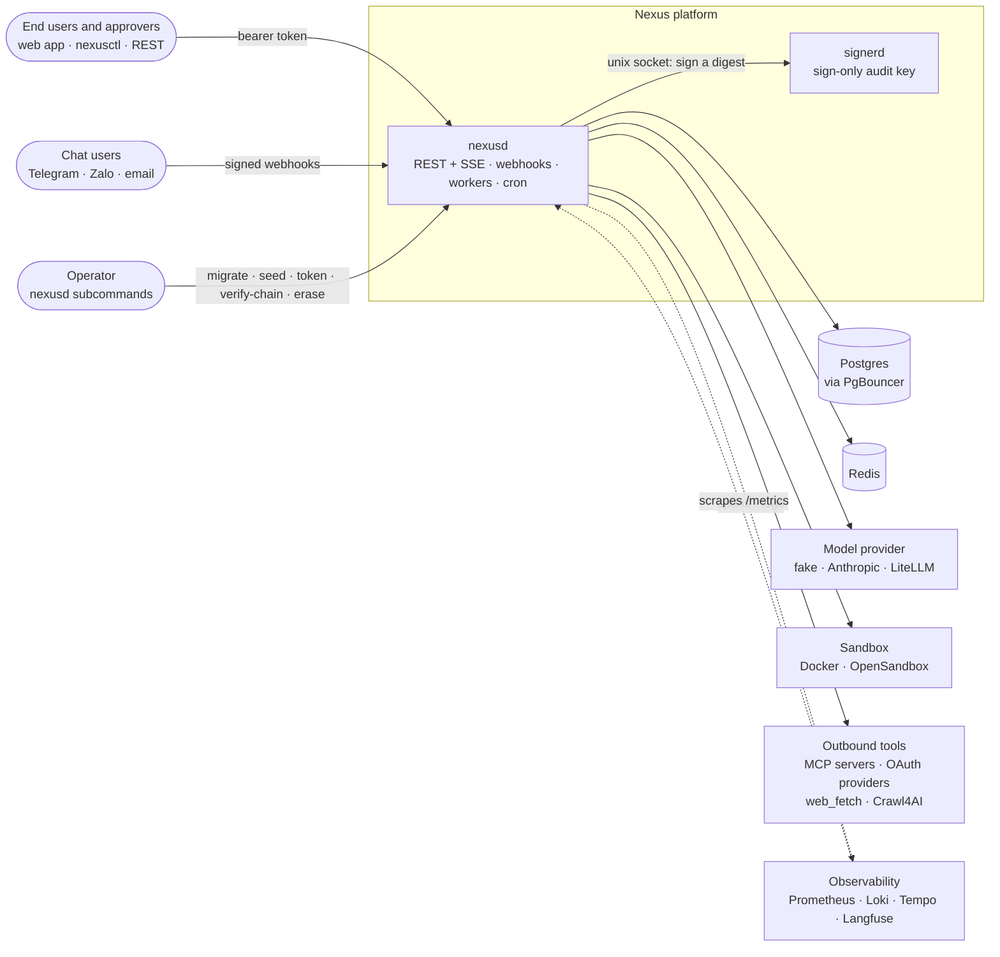

- `nexusd` is one process holding the control plane, the data plane and the REST surface. `controlplane.Port` is a Go interface, not a network hop.
- `signerd` is the only holder of the private audit key; `nexusd` can ask it to sign and nothing else.
- Operator subcommands are separate invocations of the same binary, not requests to the server.
- `web_fetch`, `connector_fetch` and every admitted MCP server's base URL share one egress allowlist (`NEXUS_WEB_FETCH_ALLOWLIST`; empty means none).

Source: [`cmd/nexusd/serve.go`](../cmd/nexusd/serve.go), [`cmd/nexusd/infra.go`](../cmd/nexusd/infra.go).

## 2. Runtime topology

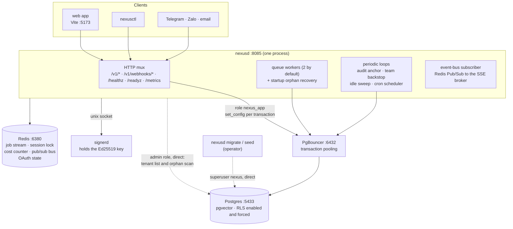

- Everything tenant-scoped goes through PgBouncer as `nexus_app` (`NOBYPASSRLS`), and scope is set with a transaction-local `set_config`, never per session, because the pooler reassigns connections between tenants.
- `nexus_app` cannot query across tenants, so the few cross-tenant passes (the tenant directory, the orphaned-session scan) open a second pool with the admin DSN, direct to Postgres. See [observation 5](#where-the-code-differs-from-the-docs).
- Redis carries five things: the job stream (`nexus:queue:jobs`, plus its delayed set and dead-letter stream), the per-session lock, the epoch-marked cost counter, the Pub/Sub bus (`nexus:events:*`, `nexus:deltas:*`) and OAuth CSRF state.
- The worker count is `NEXUS_QUEUE_WORKERS` (1 to 64), which is this process's ceiling on concurrently driven runs. `/metrics` reports the queue's depth by state, the age of its oldest job and the worker count, so workers falling behind shows as `queued` growing while the age climbs.
- Several `nexusd` processes are safe by construction but have never been run together; the periodic loops are not audited for it.

Source: [`cmd/nexusd/infra.go`](../cmd/nexusd/infra.go), [`cmd/nexusd/background.go`](../cmd/nexusd/background.go), [`cmd/nexusd/http.go`](../cmd/nexusd/http.go), [`deploy/docker-compose.yml`](../deploy/docker-compose.yml).

## 3. Who drives the kernel

Surfaces never import `kernel/`. The kernel is entered from a small, fixed set of places.

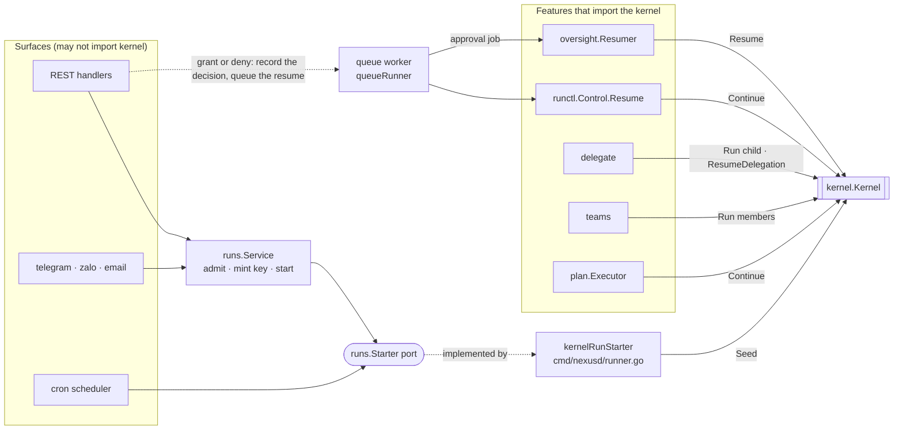

| Kernel entry | Called by | Runs on |
|---|---|---|
| `Seed` | `kernelRunStarter.StartRun` | the HTTP request goroutine: a few durable writes, then it enqueues a job |
| `Continue` | `runctl.Control.Resume`, driven by a queue job of kind start, resume or converse; also `plan` steps | a queue worker holding the session lock |
| `Resume` | `oversight.Resumer.ResumeDecided`, from an approval job a worker leases (queued by `POST /v1/approvals/{id}/grant` or `/deny`, or by recovery) | a queue worker holding the session lock |
| `ResumeDelegation` | `delegate.resumeParent` | the finishing child's goroutine, after it takes the parent's session lock |
| `Run` | `delegate.Spawn` (a child) and `teams` (members) | a detached goroutine in the process that handled the parent's tool call |
| `ResumeConversation` | no production caller: a follow-up appends the message, enqueues a job and the worker uses `Continue` | n/a |

Source: [`cmd/nexusd/runner.go`](../cmd/nexusd/runner.go), [`cmd/nexusd/background.go`](../cmd/nexusd/background.go), [`internal/oversight/resume.go`](../internal/oversight/resume.go), [`internal/delegate/spawn.go`](../internal/delegate/spawn.go).

## 4. Feature dependencies

The code is a modular monolith. A feature may import only the packages `allowedFeatureImports` lists for it ([`tests/contract/modules_test.go`](../tests/contract/modules_test.go)); a new edge fails the build until it is added, with a reason, in the diff. This is the part of that graph that explains the shape, and every edge below exists in the map. The packages that resume a run import `kernel` directly; everything else reaches it through a port.

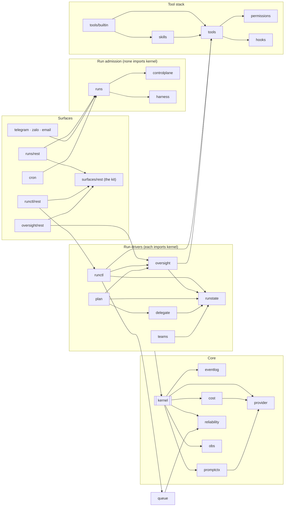

What the build refuses, beyond the graph:

- `kernel/` may not import a surface, the control plane, `internal/tools` (the pipeline reaches it through `tools/kerneladapter`) or any adapter, and may not link a database or cache driver, `net/http`, `os/exec`, the OpenTelemetry SDK, the profiler or a container SDK, even transitively.
- Thirty-three core and feature packages carry the same no-infrastructure rule. Their I/O lives in a `postgres/`, `redis/`, `inmem/`, `oauth2/` or similar subpackage that only `cmd/nexusd` wires in. `internal/sandbox` is the named exception.
- An adapter may import its own feature, the domain and the persistence kit (`store`, `audit/postgres`, `crypto/postgres`, `eventlog/sealed`), never another feature's adapter. When two features must write in one transaction, `cmd/nexusd` injects the writer.
- The three binaries may not import each other, and `cmd/nexusd` may not import `internal/audit/signerkey`, the private-key package.

Source: [`tests/contract/boundaries_test.go`](../tests/contract/boundaries_test.go), [`tests/contract/modules_test.go`](../tests/contract/modules_test.go), [`cmd/nexusd/compose.go`](../cmd/nexusd/compose.go).

## 5. Table ownership

Every table has one owner, and SQL that names it stays in the owner's package tree ([`tests/contract/ownership_test.go`](../tests/contract/ownership_test.go) lists all 37). The session and event aggregate is the one shared kernel; no feature table has a foreign key into `sessions`.

```mermaid
flowchart LR
    hub["Shared kernel, owned by eventlog<br/>sessions · events · snapshots<br/>referenced by session id value,<br/>never by foreign key"]

    subgraph owned["Feature-owned tables"]
        direction TB
        o1["audit: audit_receipts · audit_anchors"]
        o2["crypto: encryption_keys"]
        o3["cost: budgets · budget_decisions<br/>cost_records · price_book"]
        o4["oversight: approvals · input_requests"]
        o5["runctl: checkpoints · claims · session_forks"]
        o6["delegate: delegations · fanout_envelopes<br/>session_lineage"]
        o7["teams: teams · team_members<br/>team_envelopes · board_cards"]
        o8["plan: orchestration_plans · plan_sessions"]
        o9["surfaces: deliveries · inbound_deliveries<br/>messaging_channels · cron_schedules · mcp_servers"]
        o10["retrieval: documents · retrieval_chunks"]
        o11["tools: derived_artifacts<br/>contentaccess: content_access_grants<br/>connectors: oauth_connections"]
        o12["tenancy: tenants · config: tenant_configs<br/>sandbox: sandboxes"]
    end

    hub -.->|"session_id, by value"| owned
```

`sessions` keeps only what every resumer needs: `autonomy_level` and `conversational` are `kernel.RunConfig` fields pinned at creation. What a feature records about a session goes in its own table keyed by `session_id`.

## 6. Session lifecycle

`sessions.status` is a projection of the log. An event that justifies a status (the terminal event, a suspension, the conversational pause) is written with it in one transaction (`AppendAndSetStatus`); a status no event justifies (a run starting or resuming) is written with `SetStatus` on its own.

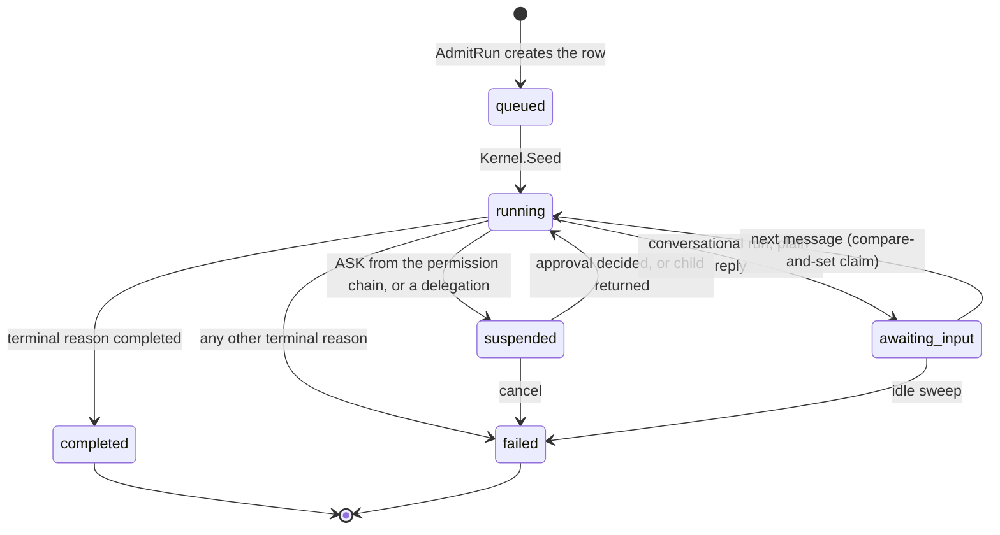

A run ends under exactly one of ten typed terminal reasons. Switches over them are exhaustive by lint rule, and a `default:` does not satisfy it.

| Reason | Produced by |
|---|---|
| `completed` | the loop: a plain reply, in a non-conversational run |
| `max_turns_exceeded` | the loop: the 25-turn backstop |
| `cost_exhausted` | the loop: `Budget.Reserve` refused |
| `permission_denied` | the loop: a final DENY, an approval denial, or an approval digest mismatch |
| `stuck_terminated` | the loop: a second corroborating stuck verdict |
| `context_overflow` | the loop: the provider reported an overflow |
| `error` | the loop: any other stream failure, or truncation at max output |
| `refused` | the loop: a provider policy refusal |
| `aborted` | `runctl.Control.Cancel` |
| `idle_timeout` | `runctl` idle-conversation sweep |

Source: [`kernel/terminal.go`](../kernel/terminal.go), [`internal/eventlog/status.go`](../internal/eventlog/status.go), [`internal/runctl/cancel.go`](../internal/runctl/cancel.go).

## 7. The kernel loop

One `iter.Seq2` generator is the only place agent control flow lives. Every event is committed before it is yielded.

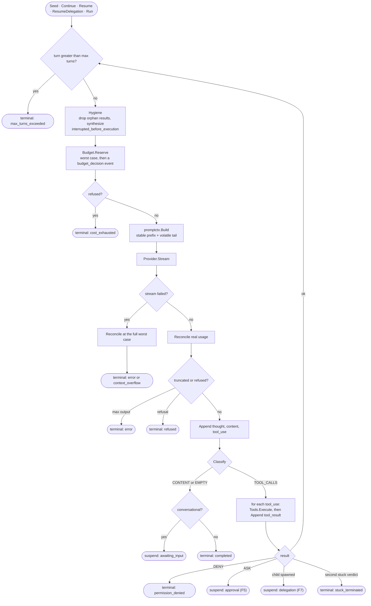

A suspension appends its event, sets the status and stops the generator with no terminal event, so a suspended run costs no tokens. `aborted` and `idle_timeout` are written by `runctl`, outside the loop. The loop's pruning and condensation steps exist but are not enabled by `nexusd` ([observation 7](#where-the-code-differs-from-the-docs)), so they are omitted here.

Source: [`kernel/turns.go`](../kernel/turns.go), [`kernel/loop.go`](../kernel/loop.go), [`kernel/hygiene.go`](../kernel/hygiene.go).

## 8. Tool pipeline and permission chain

Every tool call walks one 16-step pipeline, and step 9 is a 10-layer permission chain.

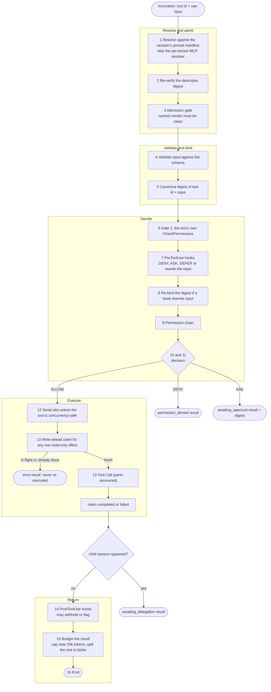

`ExecuteApproved` is the resume-time entry. It runs steps 1 to 5, compares the freshly computed digest with the one the human approved, and refuses with `approval_mismatch` if they differ. On a match it skips steps 6 to 11, since a person already decided, and continues at step 12.

The permission chain is one published total order:

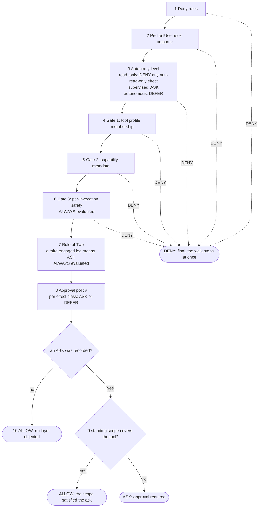

- A DENY at any of layers 1 to 6 is final. There is no bypass mode.
- An ASK does not stop the walk: layers 6 and 7 still run, and layer 9 is consulted only once every other layer has spoken. A standing scope can satisfy an ask and can never suppress one or cause a layer to be skipped.
- No layer from 1 to 8 may return ALLOW. `guardNotAllow` checks this at run time, since a hook or a tool's `CheckPermissions` is external code.
- Autonomy is a one-way ratchet: `Pin` once, `Tighten` only toward `read_only`, and a test asserts by reflection that no widening method exists.
- The Rule of Two counts three legs (untrusted input, private data, external effect); the third one engaged in a session asks. The count advances whether or not the ask is approved.

Source: [`internal/tools/execute.go`](../internal/tools/execute.go), [`internal/tools/dispatch.go`](../internal/tools/dispatch.go), [`internal/permissions/chain.go`](../internal/permissions/chain.go), [`internal/permissions/autonomy.go`](../internal/permissions/autonomy.go), [`internal/permissions/ruleoftwo.go`](../internal/permissions/ruleoftwo.go).

## 9. Keys, sealing and the audit chain

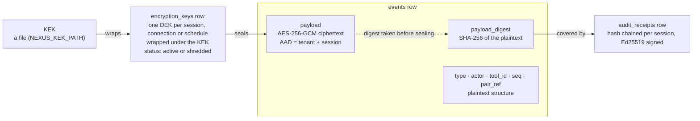

- Reads of plaintext go through one path: the run's own audience, decrypted per request on the SSE and read endpoints. Anyone else needs an audited, expiring content-access grant, which is itself receipted. Reporting reads the plaintext structural columns only.
- The digest is taken over plaintext, so erasure never breaks the audit chain.
- Durable events travel over the Redis bus still sealed. Live content previews (`nexus:deltas:*`) do not: they carry plaintext and are never stored.

The receipt chain and its anchors:

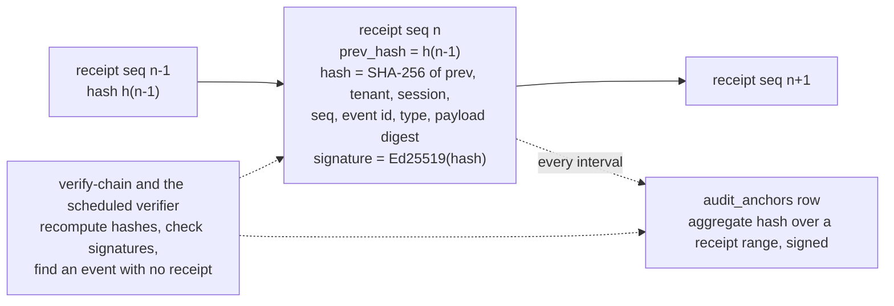

A break or a gap is logged by the scheduled verifier and returned by `nexusd verify-chain`; there is no metric or alert yet.

Source: [`internal/crypto/envelope.go`](../internal/crypto/envelope.go), [`internal/crypto/postgres/keystore.go`](../internal/crypto/postgres/keystore.go), [`internal/audit/chain.go`](../internal/audit/chain.go), [`internal/audit/postgres/chain.go`](../internal/audit/postgres/chain.go), [`internal/audit/postgres/anchor.go`](../internal/audit/postgres/anchor.go).

* * *

## F1 Start a run

The synchronous half: everything that happens before the client gets its `202`. A run's opening events are one batch, not one transaction each: through Postgres and PgBouncer with a local signer, 17 of them take a median 18.9 ms as a batch and 35.1 ms as separate appends.

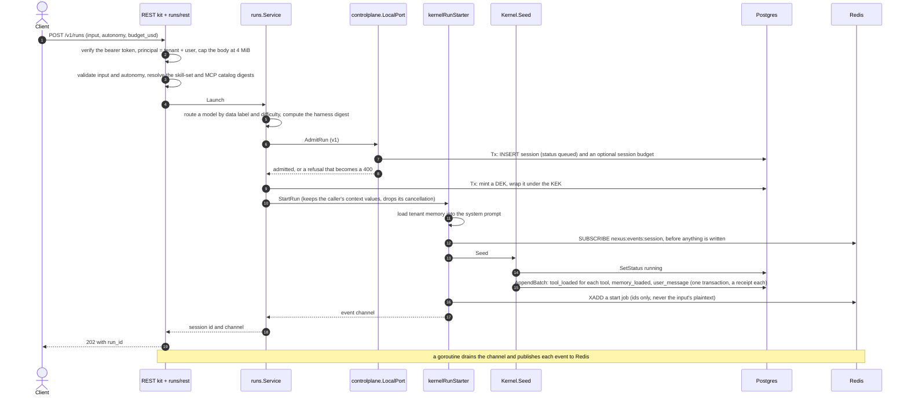

The subscription is taken before `Seed` and the enqueue because Redis Pub/Sub keeps no history: a worker's first event could otherwise be published before anyone listens. A failure after admission leaves an admitted session with no events, which is inert.

Source: [`internal/runs/rest/run_create.go`](../internal/runs/rest/run_create.go), [`internal/runs/launch.go`](../internal/runs/launch.go), [`internal/controlplane/local.go`](../internal/controlplane/local.go), [`cmd/nexusd/runner.go`](../cmd/nexusd/runner.go).

## F2 A worker drives the run and the client streams it

The asynchronous half. Any worker in any process may lease the job, and any process may hold the client's SSE connection.

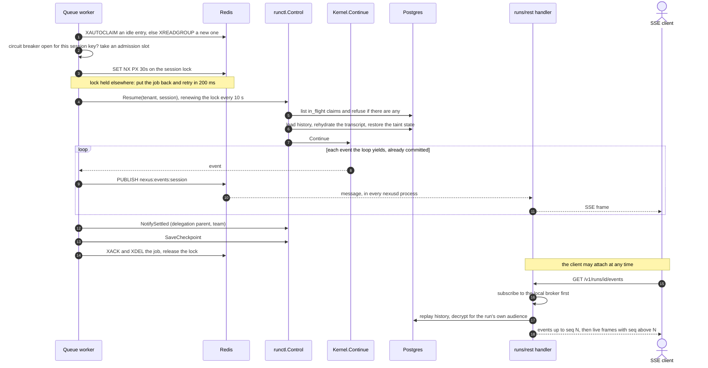

- Subscribing before replaying, then dropping any live event at or below the last replayed `seq`, makes the stream gapless and duplicate-free. A slow client whose buffer fills simply loses live frames and catches up from Postgres on reconnect.
- If the lock is lost mid-run the run is cancelled rather than left to race whoever holds it now.
- If `Resume` fails, the worker classifies the error: permanent failures go to the dead-letter stream, others retry with logged, jittered backoff, and a per-session circuit breaker stops a session that keeps failing.

Source: [`internal/queue/worker.go`](../internal/queue/worker.go), [`internal/queue/redis/streams.go`](../internal/queue/redis/streams.go), [`internal/runctl/resume.go`](../internal/runctl/resume.go), [`internal/runs/rest/run_events.go`](../internal/runs/rest/run_events.go), [`cmd/nexusd/eventbus.go`](../cmd/nexusd/eventbus.go).

## F3 One turn of the loop

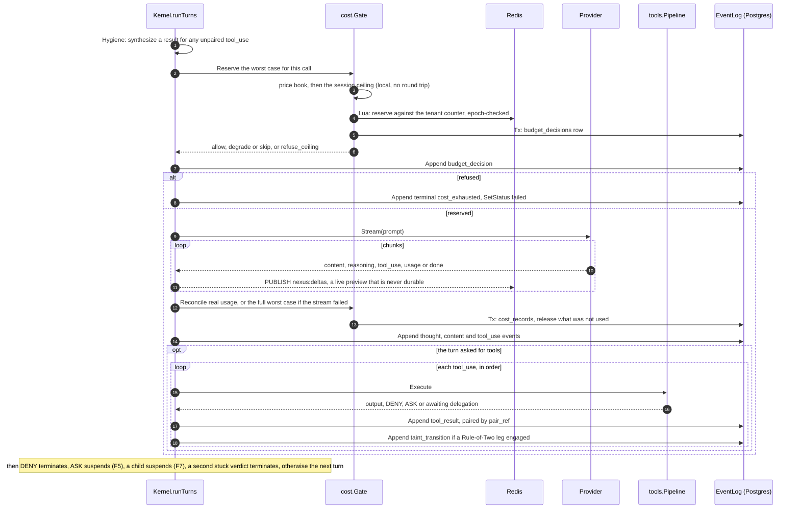

- Reserve runs before every `Provider.Stream`, including the condenser's own call; a contract test walks the AST to prove no model call is reachable unmetered.
- A stream that fails is reconciled at the full reserved worst case, so an unreliable provider never looks free.
- A reconcile failure is logged, never fatal: the call already happened, and killing a healthy run over an accounting outage would be worse.
- `budget_decisions` and `cost_records` commit in the gate's own transactions, separate from the kernel's `budget_decision` event. A crash between them leaves a row without its event, never the reverse.

Source: [`kernel/turns.go`](../kernel/turns.go), [`kernel/metering.go`](../kernel/metering.go), [`internal/cost/reserve.go`](../internal/cost/reserve.go), [`internal/cost/reconcile.go`](../internal/cost/reconcile.go).

## F4 Append one event

The write every other flow depends on. One event and its audit receipt commit together or not at all.

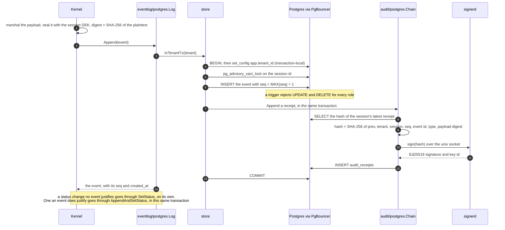

- If `signerd` is unreachable the append fails, so `nexusd` cannot write events without it. `/readyz` checks it for the same reason.
- The advisory lock serializes writers within one session. The Redis session lock is what keeps two workers off the same session in the first place.
- `SetStatus` is a second transaction. A crash between the event and the status leaves a stale projection, which matters for recovery (F6).

Source: [`internal/eventlog/postgres/log.go`](../internal/eventlog/postgres/log.go), [`internal/store/append.go`](../internal/store/append.go), [`internal/store/tenant.go`](../internal/store/tenant.go), [`internal/audit/postgres/chain.go`](../internal/audit/postgres/chain.go), [`migrations/0003_events.sql`](../migrations/0003_events.sql).

## F5 Tool approval

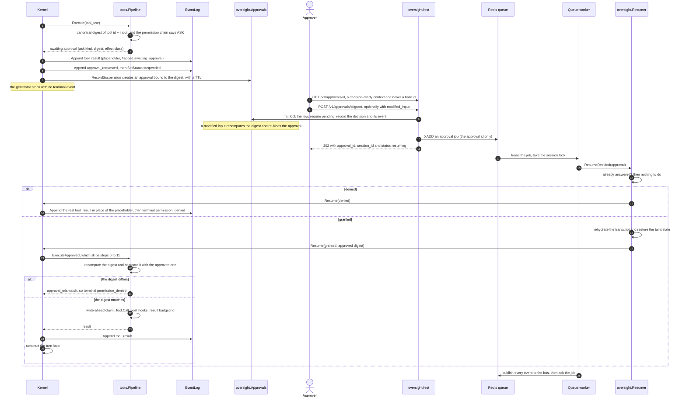

- Suspending is three commits: the placeholder result, then `approval_requested` together with the status (one atomic write), then the approval row in the hook's own transaction. A failure in the last leaves a suspended run with no approval to resolve, and nothing recovers that yet ([observation 11](#where-the-code-differs-from-the-docs)). The kernel wraps each failure with what was already written.
- Deciding and resuming are separate. The decision commits first and is answered `202`, so a client that disconnects loses nothing. The resume then runs on a worker like any other run: it holds the session lock, publishes to the event bus (so a connected SSE client and a Telegram, Zalo or email conversation see the result), and is retried by the queue.
- If the queue cannot be reached the decision still stands, the answer says `decided` instead of `resuming`, and recovery resumes any run left suspended behind a decided approval. `ResumeDecided` is safe to run twice: a call that already has its real result is skipped.
- The placeholder is replaced in place by the real result, so the model sees one `tool_result` per `tool_use`.
- Steering or cancelling a suspended run invalidates its pending approval and appends a synthetic result, so the model is told the call was superseded.

Source: [`kernel/terminal.go`](../kernel/terminal.go), [`internal/oversight/decide.go`](../internal/oversight/decide.go), [`internal/oversight/resume.go`](../internal/oversight/resume.go), [`internal/oversight/rest/handler.go`](../internal/oversight/rest/handler.go), [`cmd/nexusd/approvals.go`](../cmd/nexusd/approvals.go), [`internal/tools/execute.go`](../internal/tools/execute.go).

## F6 Crash recovery

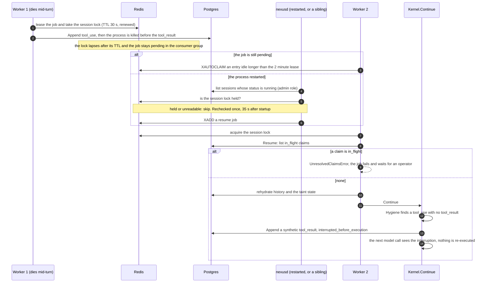

- A write-ahead claim goes `in_flight` before an effect leaves the process and is resolved by a probe or a person, never silently re-executed and never discarded. Resume refuses to start while one is unresolved.
- The orphan scan trusts `status = running`. A terminal event and a suspension now commit with their status, so a finished or suspended run is not seen as running; a run that starts or resumes sets `running` on its own. It is not a periodic loop on purpose: an orphan whose resume fails for good would be re-enqueued forever.
- A suspended or awaiting-input session is never treated as an orphan, and `Resume` refuses both states.

Source: [`internal/runctl/recovery.go`](../internal/runctl/recovery.go), [`internal/runctl/resume.go`](../internal/runctl/resume.go), [`kernel/hygiene.go`](../kernel/hygiene.go), [`internal/tools/dispatch.go`](../internal/tools/dispatch.go), [`cmd/nexusd/background.go`](../cmd/nexusd/background.go).

## F7 Delegation to a child session

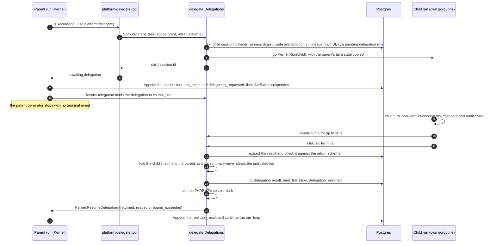

- The child runs on a goroutine, not through the queue. The parent's resume does take the session lock, and a child that dies is picked up by the same orphan sweep as any other `running` session.
- `awaitBound` exists because the child can finish before the parent has committed the bind; without it a result could be resolved against no `tool_use`.
- `OnChildTerminal` is also reached through `runctl.SettledObserver` when a worker or an approval decision finishes a child that had suspended. A delegation that belongs to a plan fan-out resolves through the fan-out instead of resuming a parent.

Source: [`internal/delegate/spawn.go`](../internal/delegate/spawn.go), [`internal/delegate/resolve.go`](../internal/delegate/resolve.go), [`internal/delegate/bindwait.go`](../internal/delegate/bindwait.go), [`internal/runctl/settled.go`](../internal/runctl/settled.go).

## F8 Chat webhook

Telegram shown; Zalo and email follow the same shape with their own authenticity checks.

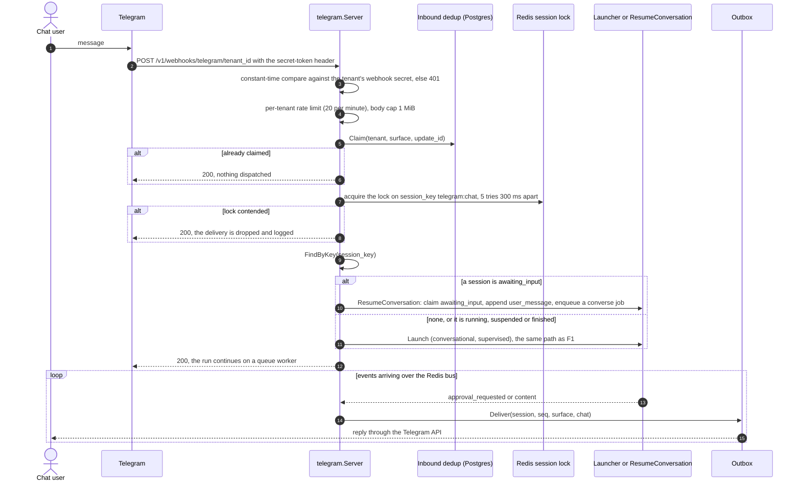

- `tenant_id` in the path is a routing key, not a credential. The secret is checked before the body is parsed.
- Redelivery is caught by `update_id` (a delivery id), not by a timestamp window, so there is no replay bound. The rate limit is per tenant, not per sender, and in memory, so per process.
- This lock is keyed on the surface's `session_key`, deliberately not the session id the queue workers lock for a whole run: sharing one would make every delivery wait out the turn in flight.
- A decision on an approval raised from a chat run goes through the REST approval path (F5). Its resume runs on a worker and publishes to the bus, so the chat user receives the result like any other reply.

Source: [`internal/surfaces/telegram/webhook.go`](../internal/surfaces/telegram/webhook.go), [`internal/surfaces/lock.go`](../internal/surfaces/lock.go), [`internal/runctl/converse.go`](../internal/runctl/converse.go), [`cmd/nexusd/surfaces_wiring.go`](../cmd/nexusd/surfaces_wiring.go).

## F9 Erasure

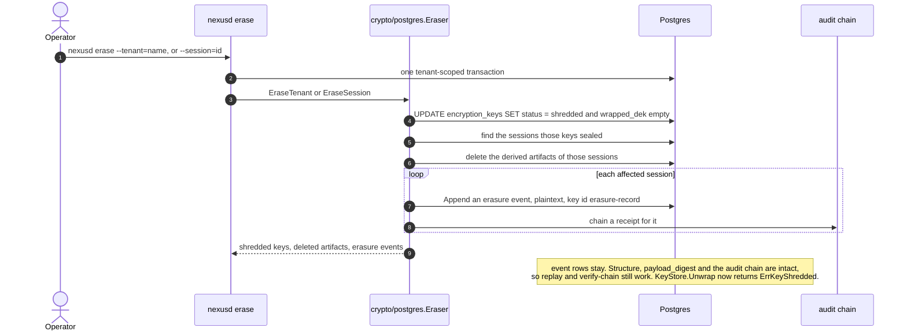

The row stays so a verifier can prove a key was retired, but its `wrapped_dek` is emptied in the same statement, so there is nothing left to unwrap. A database backup taken before the shred still holds the old bytes; see [observation 3](#where-the-code-differs-from-the-docs).

Source: [`cmd/nexusd/cli_erase.go`](../cmd/nexusd/cli_erase.go), [`internal/crypto/postgres/erase.go`](../internal/crypto/postgres/erase.go), [`internal/crypto/postgres/shred.go`](../internal/crypto/postgres/shred.go), [`migrations/0004_encryption_keys.sql`](../migrations/0004_encryption_keys.sql).

* * *

## Where the code differs from the docs

Found while drawing the diagrams above. **Checked** means a test or a reproduction; **read** means the code was read and not run. Rows marked fixed were resolved after this document first listed them; the rest are open, and each deserves a decision in the spec that owns it.

| # | What the code does | Evidence | Status |
|---|---|---|---|
| 1 | **Fixed.** An approval decision used to resume the run inside the HTTP request and drain it, never calling `PublishEvent`, so connected SSE clients and chat conversations got no live events from the resumed turns, a second approval in the same run sent no notification, and a run that ended on that path emitted no `run.terminal` span. A decision now records itself, answers `202`, and queues an approval job that a worker resumes under the session lock, publishing as every other run does. | `internal/oversight/decide.go`, `internal/oversight/resume.go`, `cmd/nexusd/approvals.go` | checked: unit tests, and integration tests for `ResumeDecided`, its repeat, and recovery |
| 2 | **Fixed.** After an approved call the next model prompt held two `tool_result` blocks for one `tool_use`: the `awaiting_approval` placeholder and the real result. `Rehydrate` now picks one answer per call and `Resume` replaces the placeholder in place; the scripted provider now refuses a malformed prompt, so a test sees it. | `kernel/rehydrate.go`, `kernel/transcript.go`, `internal/provider/validate.go` | checked: kernel tests and mutation checks |
| 3 | **Fixed.** Erasure used to set `encryption_keys.status = 'shredded'` and keep `wrapped_dek`, so anyone with database access and the KEK file could still unwrap what the key sealed: irreversibility rested on the status check alone. Shredding now empties `wrapped_dek` in the same statement, and migration 0030 does the same for keys shredded earlier. The row stays as proof the key was retired. A backup or WAL taken before the shred still holds the old bytes, and only retiring the KEK they were wrapped under removes those. | `internal/crypto/postgres/shred.go`, `migrations/0030_wipe_shredded_keys.sql` | checked: integration tests for both |
| 4 | A DEK is minted per session (and per OAuth connection and per cron schedule), not once per tenant. The README says "a KEK wraps per-tenant DEKs". Tenant erasure shreds all of a tenant's active keys; `--session` shreds one session's. | `NewDEK` call sites in `runs`, `delegate`, `teams`, `runctl/fork`, `connectors`, `cron` | read |
| 5 | The README and CLAUDE.md say the superuser `nexus` role is for migrations only. The running server also opens a pool with the admin DSN (`NEXUS_ADMIN_DATABASE_URL`, falling back to the migrate DSN) for the tenant directory and the orphan scan. | `adminDSN` and its callers in `cmd/nexusd/background.go` | read |
| 6 | `provider.Route` picks a model id, but nothing in a model call carries it: `Prompt` and `RunContext` have no model field and each adapter is bound to the one model it was configured with, and `nexusd` wraps a single provider, so failover has nothing to fail over to. The cost ceiling used to be priced under the routed model and enforced against a figure that was not on the bill. It is now priced under the model the provider serves (`provider.ServedModel`), and the router's choice is kept in `route_reason`. Routing still does not dispatch. | `internal/provider/provider.go`, `internal/provider/bound.go`, `internal/runs/launch.go`, `cmd/nexusd/compose.go` | checked: a launcher test and a seed test |
| 7 | `Kernel.PrunePolicy` and `Kernel.CondenseThresholdBytes` were never set by `cmd/nexusd`, so live pruning and condensation were off in the shipped binary and a long conversation grew until the provider reported an overflow. They are now settings (`NEXUS_CONTEXT_PRUNING`, `NEXUS_CONDENSE_THRESHOLD_BYTES`), still off by default: they change what the model is shown, so enabling one is a prompt change that has to clear the eval gate against the model in use. | `cmd/nexusd/context_policy.go`, `cmd/nexusd/compose.go` | checked: a unit test; the quality effect is not measured |
| 8 | Delegated children and team members run on detached goroutines in the process that handled the parent's tool call, not through the queue or its lock. | `internal/delegate/spawn.go`, `internal/teams/lifecycle.go` | read |
| 9 | Live content previews cross Redis Pub/Sub as plaintext. The code accepts this on the assumption that Redis is on a private network. Durable events on the same bus are sealed. | `PublishDelta` in `internal/runs/rest/broker.go` | read |
| 10 | The README's list of tenant tables is out of date against the 37 tables in `tableOwners` (for example `claims`, not `idempotency_claims`; there is no `tools`, `tool_profiles` or `catalog_manifests` table), and its repository-layout block lists `runs/`, `surfaces/`, `connectors/`, `retrieval/`, `contentaccess/` and `tenancy/` twice. This document takes its table list from `tests/contract/ownership_test.go`. | the two files side by side | read |
| 11 | A suspension is still three commits. The placeholder result is appended first, `approval_requested` and the status commit together, and the approval row (or the delegation bind) is written afterwards in the hook's own transaction. A failure or a crash before the last leaves a suspended run with no approval to resolve, and nothing recovers it: orphan recovery looks for `running`, and `ListUnresumed` for an approval that exists. Closing it means joining the hook into the suspension's transaction. | `kernel/terminal.go`, `internal/eventlog/postgres/log.go`, `cmd/nexusd/ports.go` | read |
| 12 | A crash between `Reserve` and `Reconcile` leaves the tenant's Redis counter charged for the full worst case and the ledger with no record of it. The counter is on the safe side, which matches the policy that unreported usage is charged in full, but the ledger and the counter disagree until Redis is re-armed. Reconciling needs a durable reservation id on `budget_decisions`, which does not exist. | `internal/cost/reserve.go`, `internal/cost/reconcile.go` | read |
| 13 | The pipeline's per-session state (pinned autonomy and the Rule-of-Two projection) is never evicted. Evicting it is not safe yet: delegation reads a finished child's taint from it (`TaintStateFor`) after the child has ended, so dropping it would clear the child's legs from the parent. The fix is for delegation to read the child's taint from the log. | `internal/tools/pipeline.go`, `internal/delegate/resolve.go` | read |
